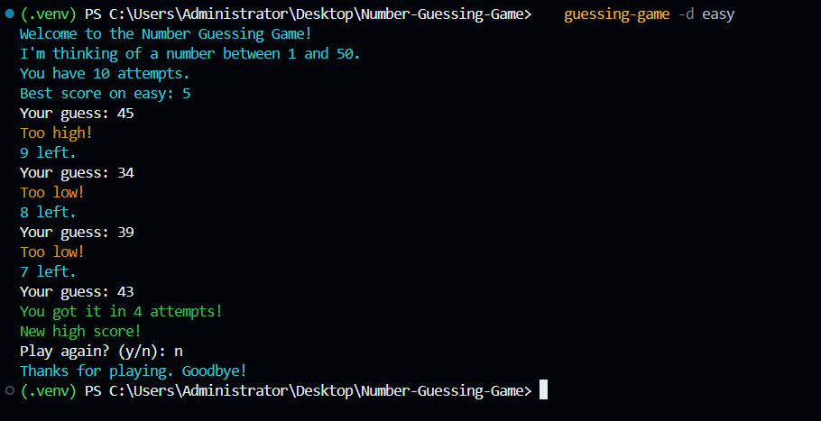

# Number Guessing Game

> A command-line number guessing game in Python with difficulty levels,
> attempt limits, colored output, and persistent high scores.




## Features

-  Random number with "too high / too low" hints
-  Three difficulty levels, each with its own range and attempt limit
-  Persistent high scores (best attempt count per difficulty)
-  Input validation: handles empty input, letters, and out-of-range numbers
-  Colored terminal output
-  Command-line options for difficulty and attempt limit
-  Unit tests with pytest

## Difficulty Levels

| Level  | Range  | Max attempts |
|--------|--------|--------------|
| Easy   | 1-50   | 10           |
| Medium | 1-100  | 7            |
| Hard   | 1-500  | 9            |

## Installation

Requires Python 3.9 or newer.

```bash
git clone https://github.com/YOUR-USERNAME/number-guessing-game.git
cd number-guessing-game
python -m venv .venv
```

Activate the virtual environment:

```bash
# macOS / Linux
source .venv/bin/activate

# Windows (PowerShell)
.venv\Scripts\Activate.ps1
```

Install the game:

```bash
pip install -e .
```

## Usage

```bash
guessing-game                       # choose difficulty from a menu
guessing-game -d hard               # skip the menu
guessing-game -d easy -m 3          # custom attempt limit
guessing-game --help                # see all options
```

You can also run it as a module: `python -m guessing_game.cli`

## Running Tests

```bash
pip install -r requirements-dev.txt
pytest
```

## Project Structure

```
number-guessing-game/
├── src/guessing_game/
│   ├── game.py      # gameplay logic
│   ├── cli.py       # argparse command-line interface
│   ├── scores.py    # JSON high-score storage
│   └── ui.py        # colored output helpers
├── tests/           # pytest unit tests
├── pyproject.toml   # packaging and tool config
└── README.md
```

## What I Learned

- Structuring a Python project with the `src/` layout and packaging it
- Separating pure logic from I/O so it can be unit tested
- Persisting data safely with JSON and defensive error handling
- Building a CLI with `argparse` and writing testable entry points
- Writing meaningful commits with Conventional Commits

## License

MIT